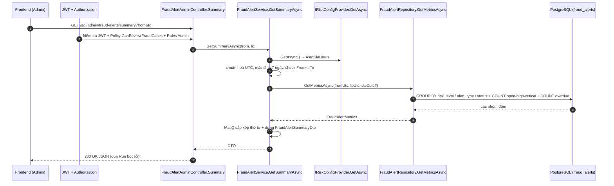
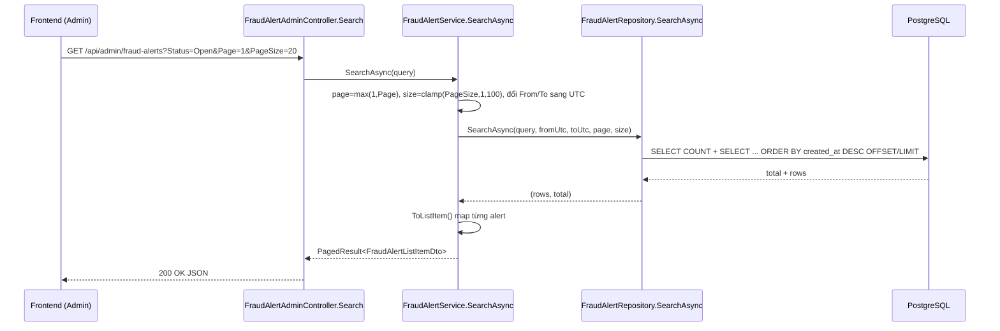
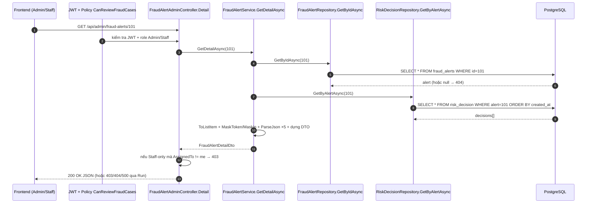

# View Fraud Alert Dashboard & View Fraud Alert Details (AdminAPI)

> Phạm vi: `AdminAPI` — fraud/risk. Không đụng tới Support Case (theo memory `adminapi-repository-scope`).
> Tất cả nhận định dựa trên code thật tại thời điểm đọc. Dòng `File:line` là bằng chứng.

---

## A. CHỨC NĂNG 1 — VIEW FRAUD ALERT DASHBOARD (màn hình tổng quan)

### 1. Nghiệp vụ là gì

**Dùng để làm gì, ai dùng:**
- Màn hình tổng quan cho đội chống gian lận / bot nhìn nhanh "hôm nay / 7 ngày qua có bao nhiêu cảnh báo, cái nào nguy hiểm, cái nào trễ xử lý".
- Gồm 2 API con trong cùng controller `api/admin/fraud-alerts`:
  - `GET api/admin/fraud-alerts/summary?from=...&to=...` → các con số tổng hợp.
  - `GET api/admin/fraud-alerts?...` (Search) → danh sách alert phân trang để hiển thị bảng.
- **Chỉ Admin** được xem Dashboard (`[Authorize(Roles = "Admin")]` trên cả 2 action). Staff muốn xem case phải đi qua FraudCase queue (`FraudCaseAdminController`), không dùng 2 endpoint này.

**Dữ liệu hiển thị là gì:**

| Chỉ số | Ý nghĩa |
|---|---|
| `Total` | Tổng số alert được tạo trong khoảng `[From, To]`. Tính bằng `byLevel.Sum` (tổng các nhóm level) |
| `OpenHighOrCritical` | Số alert đang `Open` hoặc `InReview` **và** mức `High` hoặc `Critical` — tức "việc nguy hiểm còn tồn đọng" |
| `OverdueSla` | Tập con của trên, thêm điều kiện `CreatedAt < slaCutoff` (quá SLA chưa xử lý). `slaCutoff = UtcNow - cfg.AlertSlaHours` (mặc định 2 giờ) |
| `ByLevel` | Đếm theo `RiskLevel`: Critical / High / Medium / Low (sắp xếp theo thứ tự cố định này) |
| `ByType` | Đếm theo `AlertType` (loại dominant): `Bot` / `Fraud` |
| `ByStatus` | Đếm theo `Status`: Open / InReview / Resolved / FalsePositive / Dismissed |
| Danh sách (Search) | Mỗi dòng là `FraudAlertListItemDto`: id, user, loại, mức, điểm, trạng thái, thời gian tạo, ai review, giao cho ai |

**Khái niệm nghiệp vụ liên quan:**
- **alert** (`fraud_alerts`): một cảnh báo gian lận/bot được hệ thống risk engine tạo ra khi điểm risk ≥ High (xem `UpsertAlertAsync`). Một alert gom nhiều `risk_decision` (mỗi scope block/hold một dòng).
- **risk decision** (`risk_decision`): quyết định chặn/giữ/thử thách cụ thể (Action = BLOCK/HOLD/CHALLENGE...), có scope (ACCOUNT/TICKET/IP...).
- **risk level**: Low / Medium / High / Critical — suy ra từ điểm số và ngưỡng trong `RiskConfig` (`ThresholdMedium/High/Critical`, mặc định 30/60/80).
- **alert type**: `Bot` hoặc `Fraud` — phe nào điểm cao hơn (dominant) thì alert mang tên đó.
- **status**: `Open` (mới), `InReview` (đang xem), `Resolved` (đã xử lý đúng), `FalsePositive` (báo nhầm), `Dismissed` (bỏ qua).
- **SLA quá hạn**: alert High/Critical mà từ lúc tạo đến nay đã quá `risk.alert.sla_hours` (mặc định 2h) vẫn còn Open/InReview.
- **case được giao cho analyst**: cột `assigned_to`/`assigned_at` trên alert (do Admin giao qua FraudCase flow). Dashboard **không** kiểm tra assignment — chỉ màn Details mới kiểm tra với Staff.

**Quyền và mã lỗi:**
- Không có JWT / sai JWT → `401` (do middleware JWT).
- Đã đăng nhập nhưng không phải Admin (kể cả Staff) gọi `summary` hoặc `search` → `403` (do `[Authorize(Roles="Admin")]`).
- `From > To` → `400 { message: "From must be less than or equal to To." }` (service ném `RiskServiceException(400)`).
- Lỗi không lường trước → `500 { message: "An unexpected error occurred..." }` (controller `Run` bắt và log).

### 2. Chỗ xử lý code nằm ở đâu (Dashboard)

| Tầng | File | Class / Method | Vai trò | Dòng |
|---|---|---|---|---|
| Controller | `backend/AdminAPI/Controllers/FraudAlertAdminController.cs` | `FraudAlertAdminController.Summary`, `.Search`, `.Run` | Nhận HTTP, phân quyền, gọi service, bọc lỗi | 27-36, 66-75 |
| Service interface | `backend/AdminAPI/Services/Risks/FraudAlertService.cs` | `IFraudAlertService.GetSummaryAsync`, `.SearchAsync` | Hợp đồng DI | 19-20 |
| Service | `backend/AdminAPI/Services/Risks/FraudAlertService.cs` | `FraudAlertService.GetSummaryAsync` | Mặc định khoảng thời gian, tính SLA, sắp xếp nhóm đếm | 231-258 |
| Service | `backend/AdminAPI/Services/Risks/FraudAlertService.cs` | `FraudAlertService.SearchAsync`, `.ToListItem`, `.ToUtc` | Chuẩn hoá trang, chuyển UTC, map entity→DTO | 260-277, 654-659, 667-682 |
| Repository interface | `backend/AdminAPI/Repositories/IFraudAlertRepository.cs` | `GetMetricsAsync`, `SearchAsync` | Hợp đồng truy vấn alert | 29-33 |
| Repository | `backend/AdminAPI/Repositories/FraudAlertRepository.cs` | `GetMetricsAsync` | 3 câu GROUP BY + 2 câu COUNT | 33-58 |
| Repository | `backend/AdminAPI/Repositories/FraudAlertRepository.cs` | `SearchAsync` | Lọc + đếm tổng + phân trang | 60-77 |
| DTO | `backend/AdminAPI/DTOs/RiskDTOs.cs` | `FraudAlertQuery`, `FraudAlertSummaryDto`, `CountItemDto`, `FraudAlertListItemDto`, `PagedResult` | Hình dạng request/response | 55-96; `PagedResult.cs:4-11` |
| Model | `backend/AdminAPI/Models/FraudAlert.cs` | `FraudAlert` | Ánh xạ bảng `fraud_alerts` | toàn file, đặc biệt 36-68 |
| DbContext | `backend/AdminAPI/Data/AdminDbContext.cs` | `AdminDbContext.FraudAlerts`, `OnModelCreating` | DbSet + default `Low`/`Open`/`now()` | 17, 42-52 |
| Config | `backend/AdminAPI/Services/Risks/RiskConfig.cs` | `RiskConfig.AlertSlaHours` (=2), `Parse` case `risk.alert.sla_hours` | Ngưỡng SLA | 80, 166 |
| DI | `backend/AdminAPI/Services/Risks/RiskServiceCollectionExtensions.cs` | `AddRiskEngine` | Đăng ký `IFraudAlertService`, `RiskScoreCalculator`... | 7-13 |
| DI | `backend/AdminAPI/Repositories/RepositoryServiceCollectionExtensions.cs` | `AddAdminRepositories` | Đăng ký `IFraudAlertRepository`... | 10-18 |
| DI/Auth | `backend/AdminAPI/Program.cs` | policy `CanReviewFraudCases`, JWT Bearer, `AddRiskEngine`, `AddAdminRepositories` | Cửa bảo vệ + lắp DI | 36-53, 73-74, 113, 28 |

### 3. Luồng xử lý qua các class (Dashboard)

#### 3a. Summary



**DI liên quan:** Controller nhận `IFraudAlertService _service` qua constructor (`FraudAlertAdminController.cs:18-24`), implementation `FraudAlertService` được đăng ký Scoped tại `RiskServiceCollectionExtensions.cs:12`. Service nhận `IFraudAlertRepository _alerts` + `IRiskConfigProvider _config` qua constructor (`FraudAlertService.cs:50-68`). Repository nhận `AdminDbContext db` theo kiểu primary-constructor (`FraudAlertRepository.cs:8`). DbContext + repository được lắp ở `Program.cs:13-14, 28, 113`.

**Câu truy vấn đếm viết thế nào** (`FraudAlertRepository.cs:33-58`):
- `q = FraudAlerts.AsNoTracking().Where(CreatedAt in [from, to])` — khung thời gian chung cho mọi con số.
- `byLevel / byType / byStatus`: `q.GroupBy(...).Select(Key, Count)` → 3 round-trip SQL `GROUP BY`.
- `openHigh`: `q.Count(Status in {Open,InReview} && RiskLevel in {High,Critical})`.
- `overdue`: thêm `CreatedAt < slaCutoff`.
- `Total = byLevel.Sum(Count)` (cộng ở memory, không phải `COUNT(*)` riêng).

**Khoảng thời gian mặc định** (`FraudAlertService.cs:234-235`): `toUtc = To ?? UtcNow`; `fromUtc = From ?? toUtc-7 ngày`. `ToUtc()` ép mọi input về UTC (Utc giữ nguyên; Local → `ToUniversalTime()`; Unspecified → gắn `Utc`).

**Cách tính quá hạn SLA** (`FraudAlertService.cs:238` + repo dòng 47-49): `slaCutoff = UtcNow - AlertSlaHours` (mặc định 2h, cấu hình `risk.alert.sla_hours`). Alert nào `Open/InReview + High/Critical + CreatedAt < cutoff` là quá hạn. Lưu ý: tính từ `CreatedAt`, không phải lần cập nhật cuối.

**Cách lấy "mở mức High/Critical"**: cùng điều kiện trên nhưng bỏ điều kiện thời gian.

**Request / response mẫu (dữ liệu minh họa):**

```bash
curl -H "Authorization: Bearer <ADMIN_JWT>" \
  "https://localhost:5001/api/admin/fraud-alerts/summary?from=2026-11-21T00:00:00Z&to=2026-11-28T00:00:00Z"
```

```json
// 200 OK — ví dụ minh họa
{
  "from": "2026-11-21T00:00:00Z",
  "to": "2026-11-28T00:00:00Z",
  "total": 42,
  "openHighOrCritical": 7,
  "overdueSla": 3,
  "byLevel": [
    { "key": "Critical", "count": 2 },
    { "key": "High", "count": 10 },
    { "key": "Medium", "count": 18 },
    { "key": "Low", "count": 12 }
  ],
  "byType": [
    { "key": "Bot", "count": 25 },
    { "key": "Fraud", "count": 17 }
  ],
  "byStatus": [
    { "key": "Open", "count": 9 },
    { "key": "InReview", "count": 5 },
    { "key": "Resolved", "count": 20 },
    { "key": "FalsePositive", "count": 6 },
    { "key": "Dismissed", "count": 2 }
  ]
}
```

Status code: `200` ok; `400` From>To; `401` thiếu/sai JWT; `403` không phải Admin; `500` lỗi lạ.

#### 3b. Search (bảng danh sách của Dashboard)



Ví dụ:

```bash
curl -H "Authorization: Bearer <ADMIN_JWT>" \
  "https://localhost:5001/api/admin/fraud-alerts?Status=Open&RiskLevel=High&Page=1&PageSize=20"
```

```json
// 200 OK — ví dụ minh họa
{
  "items": [
    {
      "fraudAlertId": 101, "userId": 555, "alertType": "Bot",
      "riskLevel": "High", "riskScore": 72.5, "botScore": 72.5, "fraudScore": 10.0,
      "status": "Open", "createdAt": "2026-11-28T08:10:00Z",
      "reviewedBy": null, "reviewedAt": null, "assignedTo": 12, "assignedAt": "2026-11-28T09:00:00Z"
    }
  ],
  "page": 1, "pageSize": 20, "totalCount": 9,
  "totalPages": 1
}
```

**Bảng/cột DB được đọc (Dashboard):** chỉ bảng `fraud_alerts`: `fraud_alert_id, user_id, alert_type, risk_score, bot_score, fraud_score, risk_level, status, created_at, reviewed_by, reviewed_at, assigned_to, assigned_at`. Không đọc `risk_decision` ở luồng này.

### 4. Giải thích từng dòng code (Dashboard)

#### 4.1 `FraudAlertAdminController.Summary` + `Search` + `Run` (`FraudAlertAdminController.cs:27-36, 66-75`)

```csharp
[HttpGet("summary")]                                    // dòng 27
[Authorize(Roles = "Admin")]                           // dòng 28
public Task<IActionResult> Summary([FromQuery] DateTime? from, [FromQuery] DateTime? to) =>  // dòng 29
    Run(async () => Ok(await _service.GetSummaryAsync(from, to)));  // dòng 30
```

- Dòng 27 `[HttpGet("summary)]`: attribute routing — action này phục vụ `GET api/admin/fraud-alerts/summary` (nối với `[Route]` ở dòng 10). Người mới: attribute là "nhãn" gắn metadata cho class/method để framework tự map HTTP → method.
- Dòng 28 `[Authorize(Roles="Admin")]`: cộng thêm với `[Authorize(Policy="CanReviewFraudCases")]` ở cấp controller (dòng 11). Cả hai phải đạt: vừa thuộc role Admin/Staff (policy), vừa là Admin. Thực tế Staff bị chặn ở đây → 403.
- Dòng 29: `Task<IActionResult>` + `async` gián tiếp — trả về tác vụ bất đồng bộ; `IActionResult` là kiểu "kết quả HTTP trừu tượng" (`Ok(...)`, `NotFound()`...). `[FromQuery]` nghĩa là lấy `?from=...&to=...` trên URL bind vào tham số; `DateTime?` (dấu `?`) là nullable — được phép null khi không truyền.
- Dòng 30: gọi service lấy DTO rồi bọc `Ok(...)` (→ 200 JSON). Toàn bộ lambda được đưa vào `Run` để bọc try/catch tập trung.

```csharp
[HttpGet]                                              // dòng 33
[Authorize(Roles = "Admin")]                           // dòng 34
public Task<IActionResult> Search([FromQuery] FraudAlertQuery query) =>  // dòng 35
    Run(async () => Ok(await _service.SearchAsync(query)));              // dòng 36
```

- `[HttpGet]` không tham số → khớp đúng route gốc `GET api/admin/fraud-alerts`. ASP.NET tự bind `?RiskLevel=&Status=&Page=...` vào object `FraudAlertQuery` (model binding qua query string, từng property set theo tên, không phân biệt hoa thường).
- Phần còn lại giống Summary.

```csharp
private async Task<IActionResult> Run(Func<Task<IActionResult>> action)  // dòng 66
{                                                                        // 67
    try { return await action(); }                                       // 68
    catch (RiskServiceException ex) { return StatusCode(ex.StatusCode, new { message = ex.Message }); }  // 69
    catch (Exception ex)                                                 // 70
    {                                                                    // 71
        _logger.LogError(ex, "Unexpected error in fraud alert endpoint"); // 72
        return StatusCode(500, new { message = "An unexpected error occurred. Please try again later." }); // 73
    }                                                                    // 74
}                                                                        // 75
```

- `Func<Task<IActionResult>>` là "hàm không tham số trả về Task" — pattern bọc lỗi chung.
- `await` nghĩa là "treo method này, nhường thread đi làm việc khác, khi xong quay lại" — I/O (DB) không block thread.
- `RiskServiceException` (định nghĩa ở `FraudAlertService.cs:10-14`) mang `StatusCode` (400/404...) nên controller chỉ việc chuyển thành HTTP tương ứng, message giữ nguyên cho client hiển thị.
- `Exception` chung → log chi tiết ở server, trả client message chung chung (tránh lộ stack trace). `ILogger` được inject qua constructor (dòng 16, 18-24 — dependency injection: framework tự tạo và "tiêm" dependency vào constructor, đăng ký ở `Program.cs`).

**Tóm tắt:** 2 action Dashboard chỉ làm "cửa + bảo vệ + ủy thác": kiểm tra quyền Admin rồi gọi service; mọi lỗi nghiệp vụ/lạ đều qua `Run`.
**Chỗ dễ nhầm:** `[Authorize]` ở controller (policy) và ở action (role) là **AND**, không phải override. Đừng tưởng action Admin "nới" hơn.

#### 4.2 `FraudAlertService.GetSummaryAsync` (`FraudAlertService.cs:231-258`)

```csharp
public async Task<FraudAlertSummaryDto> GetSummaryAsync(DateTime? from, DateTime? to)  // 231
{                                                                                      // 232
    var cfg = await _config.GetAsync();                                                // 233
    var toUtc = to.HasValue ? ToUtc(to.Value) : DateTime.UtcNow;                       // 234
    var fromUtc = from.HasValue ? ToUtc(from.Value) : toUtc.AddDays(-7);               // 235
    if (fromUtc > toUtc) throw new RiskServiceException(400, "From must be less than or equal to To.");  // 236
```

- Dòng 233: lấy cấu hình risk (trong đó có `AlertSlaHours`) từ `IRiskConfigProvider` (cache + bảng `system_parameters`). `await` vì có thể đọc DB.
- Dòng 234-235: chuẩn hoá UTC + mặc định 7 ngày (xem mục 3a). `HasValue/Value` là cách dùng của nullable.
- Dòng 236: validate nghiệp vụ, ném exception mang status 400 để controller chuyển thành HTTP 400.

```csharp
    var slaCutoff = DateTime.UtcNow.AddHours(-cfg.AlertSlaHours);   // 238
    var metrics = await _alerts.GetMetricsAsync(fromUtc, toUtc, slaCutoff);  // 239
```

- `slaCutoff` = "mốc thời gian, alert tạo trước mốc này mà chưa xử lý thì tính là trễ".

```csharp
    static List<CountItemDto> Map(IEnumerable<(string Key, int Count)> src, string[] order)  // 241
    {                                                                                        // 242
        int Rank(string key) { var i = Array.IndexOf(order, key); return i < 0 ? int.MaxValue : i; }  // 243
        return src.OrderBy(x => Rank(x.Key)).Select(x => new CountItemDto { Key = x.Key, Count = x.Count }).ToList();  // 244
    }                                                                                        // 245
```

- Hàm `static` lồng trong method (local function): sắp xếp nhóm đếm theo thứ tự nghiệp vụ cố định (Critical trước Low...), giá trị lạ đẩy xuống cuối (`int.MaxValue`). `OrderBy/Select/ToList` là LINQ — viết truy vấn trên tập hợp trong memory ở đây (không phải SQL).

```csharp
    return new FraudAlertSummaryDto  // 247
    {                                // 248
        From = fromUtc,              // 249
        To = toUtc,                  // 250
        Total = metrics.Total,       // 251
        OpenHighOrCritical = metrics.OpenHighOrCritical,  // 252
        OverdueSla = metrics.OverdueSla,                  // 253
        ByLevel = Map(metrics.ByLevel, new[] { "Critical", "High", "Medium", "Low" }),  // 254
        ByType = Map(metrics.ByType, new[] { "Bot", "Fraud" }),                          // 255
        ByStatus = Map(metrics.ByStatus, new[] { "Open", "InReview", "Resolved", "FalsePositive", "Dismissed" })  // 256
    };                               // 257
}                                    // 258
```

- Dựng DTO trả về; `new[] {...}` là mảng chuỗi ẩn kiểu. Thứ tự mảng chính là thứ tự hiển thị trên dashboard.

**Tóm tắt:** Chuẩn hoá thời gian → lấy SLA → gọi repository đếm → sắp xếp nhóm → trả DTO.
**Chỗ dễ nhầm:** `Total` là tổng các nhóm level trong khoảng thời gian, không phải "tổng mọi alert trong DB".

#### 4.3 `FraudAlertService.SearchAsync` + `ToUtc` + `ToListItem` (`FraudAlertService.cs:260-277, 654-682`)

```csharp
public async Task<PagedResult<FraudAlertListItemDto>> SearchAsync(FraudAlertQuery qy)  // 260
{                                                                                      // 261
    var page = Math.Max(1, qy.Page);              // 262
    var size = Math.Clamp(qy.PageSize, 1, 100);   // 263
```

- Kẹp `page >= 1`, `size` trong 1..100 để chống client xin `PageSize=1000000` kéo sập DB.

```csharp
    var (rows, total) = await _alerts.SearchAsync(qy,      // 265
        qy.From.HasValue ? ToUtc(qy.From.Value) : null,     // 266
        qy.To.HasValue ? ToUtc(qy.To.Value) : null,         // 267
        page, size);                                        // 268
```

- Deconstruct tuple `(rows, total)` repository trả về. `ToUtc` ép UTC (định nghĩa dòng 654-659: `Utc` giữ nguyên; `Local` → `ToUniversalTime()`; còn lại — thường là `Unspecified` từ query string — gắn `Utc`).

```csharp
    return new PagedResult<FraudAlertListItemDto>  // 270
    {                                              // 271
        Items = rows.Select(ToListItem).ToList(),  // 272
        Page = page,                               // 273
        PageSize = size,                           // 274
        TotalCount = total                         // 275
    };                                             // 276
}                                                  // 277
```

- `rows.Select(ToListItem)` map từng entity sang DTO gọn nhẹ; `PagedResult` (`PagedResult.cs:4-11`) còn tự tính `TotalPages = Ceiling(TotalCount/PageSize)`.
- `ToListItem` (dòng 667-682) copy 1-1 các cột hiển thị bảng; không mang `Details/AiSummary/Decisions` nặng → bảng nhẹ.

**Tóm tắt:** Kẹp phân trang → UTC hoá → repository lọc + đếm → map DTO → bọc `PagedResult`.
**Chỗ dễ nhầm:** `ToUtc` ở service khác `ToUtc` private trong repository (`FraudAlertRepository.cs:121-122`) nhưng cùng ý tưởng; unspecified đều coi là UTC.

#### 4.4 `FraudAlertRepository.GetMetricsAsync` (`FraudAlertRepository.cs:33-58`)

```csharp
var q = db.FraudAlerts.AsNoTracking().Where(a => a.CreatedAt >= from && a.CreatedAt <= to);  // 36
```

- `DbSet<FraudAlert>` là "bảng qua EF Core"; `IQueryable` ở đây mới chỉ **dựng câu SQL**, chưa chạy. `AsNoTracking()` nghĩa là "chỉ đọc, không theo dõi thay đổi" → nhanh hơn, ít tốn memory. SQL thực sự chạy khi gặp `ToListAsync/CountAsync` bên dưới — mỗi `await` đó là 1 round-trip.

```csharp
var byLevel = await q.GroupBy(a => a.RiskLevel)                          // 38
    .Select(g => new { g.Key, Count = g.Count() }).ToListAsync(ct);       // 39
// byType (40-41), byStatus (42-43) tương tự
var openHigh = await q.CountAsync(a => (a.Status == "Open" || a.Status == "InReview")  // 45-46
                                        && (a.RiskLevel == "High" || a.RiskLevel == "Critical"), ct);
var overdue = await q.CountAsync(a => (a.Status == "Open" || a.Status == "InReview")   // 47-49
                                      && (a.RiskLevel == "High" || a.RiskLevel == "Critical")
                                      && a.CreatedAt < slaCutoff, ct);
return new FraudAlertMetrics(..., byLevel.Sum(x => x.Count), openHigh, overdue);  // 51-57
```

- `GroupBy/Count` dịch thành `SELECT risk_level, COUNT(*) ... GROUP BY`. `CancellationToken ct` cho phép huỷ truy vấn khi client ngắt kết nối.
- Tổng cộng **5 câu SQL** cho một lần xem dashboard — chấp nhận được vì có index (`FraudAlert.cs:10-15` + `AdminDbContext.cs:46`), nhưng vẫn là điểm có thể gộp (xem mục 5).

#### 4.5 `FraudAlertRepository.SearchAsync` (`FraudAlertRepository.cs:60-77`)

```csharp
var q = db.FraudAlerts.AsNoTracking().AsQueryable();  // 63
if (!string.IsNullOrWhiteSpace(query.RiskLevel)) q = q.Where(a => a.RiskLevel == query.RiskLevel);  // 64
... (AlertType, Status, UserId, From, To — dòng 65-69)
var total = await q.CountAsync(ct);                   // 71
var rows = await q.OrderByDescending(a => a.CreatedAt) // 72
    .Skip((page - 1) * pageSize).Take(pageSize)         // 73
    .ToListAsync(ct);                                  // 74
return (rows, total);                                  // 76
```

- Lọc động: chỉ thêm `WHERE` khi client truyền filter (so sánh chuỗi **phân biệt hoa thường** theo collation DB — `"open"` không khớp `"Open"`).
- `CountAsync` (tổng dòng cho phân trang) + `OrderByDescending + Skip/Take` (dịch thành `ORDER BY created_at DESC OFFSET ... LIMIT ...`) = 2 câu SQL. `Skip/Take` là phân trang ở DB, không tải cả bảng về memory.

### 5. Điểm cần lưu ý (Dashboard)

| # | Vấn đề | File:dòng | Mức độ |
|---|---|---|---|
| D1 | `GetMetricsAsync` chạy **5 round-trip** (3 group-by + 2 count). Có thể gộp thành 1-2 câu (conditional aggregation) để giảm latency | `FraudAlertRepository.cs:38-49` | Thấp (tối ưu) |
| D2 | Filter `RiskLevel/AlertType/Status` so sánh `==` trực tiếp, không chuẩn hoá hoa thường → `?Status=open` trả rỗng gây hiểu lầm | `FraudAlertRepository.cs:64-66` | Trung bình (UX/validate) |
| D3 | Khoảng `From/To` không giới hạn độ dài → xin cả năm vẫn chạy full `GROUP BY`. Nên chặn tối đa (ví dụ 90 ngày) | `FraudAlertService.cs:234-235` | Trung bình (hiệu năng) |
| D4 | `Summary`/`Search` Admin-only nên Staff trực ca không xem được dashboard tổng — phải qua case queue. Nếu nghiệp vụ muốn Staff xem tổng thì cần nới hoặc thêm endpoint riêng | `FraudAlertAdminController.cs:28, 34` | Nghiệp vụ — cần xác nhận |
| D5 | `Total = byLevel.Sum` nên alert có `RiskLevel` null/lạ vẫn được đếm nhưng không hiện ở nhóm nào (đã đẩy cuối). Nên có constraint/seed giá trị | `FraudAlertRepository.cs:55` | Thấp |

**Cần xác nhận (Dashboard):**
- Thứ tự `ByStatus` có `Dismissed` nhưng code tạo alert/block hiện tại chỉ dùng Open/InReview/Resolved/FalsePositive — `Dismissed` do luồng nào sinh ra?
- `overdue` tính từ `CreatedAt`; có nên tính lại từ lần leo thang/giao việc gần nhất không?

---

## B. CHỨC NĂNG 2 — VIEW FRAUD ALERT DETAILS (xem chi tiết một cảnh báo)

### 1. Nghiệp vụ là gì

**Dùng để làm gì, ai dùng:**
- Màn "hồ sơ" của một cảnh báo: ai/page nào bấm vào một dòng ở dashboard (hoặc case queue) sẽ mở trang này để điều tra rồi quyết định block/khôi phục/giao việc.
- API: `GET api/admin/fraud-alerts/{id}` — **Admin và Staff đều gọi được**, nhưng Staff bị giới hạn (xem ngay dưới).
- Ngoài alert, response còn trả **toàn bộ decisions** của alert đó + AI tóm tắt, để analyst khỏi mở nhiều màn hình.

**Dữ liệu hiển thị là gì:**
- `alert`: dòng tóm tắt (giống một dòng ở bảng Search) — id, user, loại, mức, điểm bot/fraud/risk, trạng thái, ai review, giao cho ai.
- `orderId/ticketId/eventId/sessionId/details`: ngữ cảnh giao dịch (session đã **che** còn 8 ký tự + "…").
- `aiSummary`: JSON tóm tắt do AI sinh (có thể null nếu chưa chạy hoặc điểm thấp). Lưu ở cột `ai_summary` (jsonb) nhưng C# đọc dạng string rồi parse thành `JsonElement?`.
- `decisions[]`: mỗi quyết định gồm mã, mức, hành động (BLOCK/HOLD...), scope, trạng thái, điểm, dominant, hard-rule, rule version, escalation, hạn, ai xử/Staff xử, lý do tay, IP (**che** còn /24 hoặc prefix IPv6), session/device (**che**), và 4 khối JSON đã parse: `scoreByGroup` (điểm theo nhóm rule), `triggeredRules` (rule nào nổ, điểm bao nhiêu), `trustModifiers` (điểm trừ do tin cậy), `signalsMissing` (tín hiệu nào thiếu).

**Khái niệm nghiệp vụ:** kế thừa Dashboard, thêm:
- **decision detail**: lịch sử các lần engine/Staff ra quyết định trên cùng alert (một alert → nhiều decision, quan hệ `FraudAlert 1—N RiskDecision` qua `fraud_alert_id`).
- **rule đã kích hoạt**: các rule bot/fraud nổ ở thời điểm ingest, lưu dạng JSON.
- **score bot/fraud**: điểm thành phần; `riskScore` là điểm quyết định (max hoặc tổng hợp).
- **case được giao cho analyst**: `assigned_to`. Staff chỉ được xem alert **được giao cho chính họ** (`AssignedTo == myUserId`), nếu không → 403 (kiểm tra ở controller, không phải service).

**Quyền và mã lỗi:**
- Chưa đăng nhập / token hỏng → `401`.
- Role khác Admin/Staff (ví dụ SupportStaff) → `403` (policy `CanReviewFraudCases`).
- Staff xem alert không giao cho mình (kể cả `AssignedTo = null` hoặc của người khác) → `403 { message: "This case is not assigned to you." }`.
- Không tồn tại `id` → `404 { message: "Alert not found." }`.
- `id` không phải số (route `{id:int}` không khớp) → `404` của routing.
- Lỗi lạ → `500`.

### 2. Chỗ xử lý code nằm ở đâu (Details)

| Tầng | File | Class / Method | Vai trò | Dòng |
|---|---|---|---|---|
| Controller | `backend/AdminAPI/Controllers/FraudAlertAdminController.cs` | `Detail`, `IsStaffOnly`, `CurrentUserId` | Lấy id, gọi service, **chặn Staff xem case người khác** | 39-53, 60-64 |
| Service | `backend/AdminAPI/Services/Risks/FraudAlertService.cs` | `GetDetailAsync`, `ParseJson`, `ToListItem` | Tải alert + decisions, che PII, parse JSON, dựng DTO | 279-328, 661-665, 667-682 |
| Repository (alert) | `backend/AdminAPI/Repositories/FraudAlertRepository.cs` | `GetByIdAsync` | Đọc 1 alert (no-tracking) | 12-13 |
| Repository (decision) | `backend/AdminAPI/Repositories/RiskDecisionRepository.cs` | `GetByAlertAsync` | Đọc decisions của alert, xếp theo `CreatedAt` tăng dần | 17-21 |
| Helper che PII | `backend/AdminAPI/Services/Risks/RiskSupport.cs` | `MaskToken`, `MaskIp` | Che session/device/IP | 7-16 |
| DTO | `backend/AdminAPI/DTOs/RiskDTOs.cs` | `FraudAlertDetailDto`, `RiskDecisionDetailDto`, `FraudAlertListItemDto` | Hình dạng response chi tiết | 98-141, 81-96 |
| Model/DB | `backend/AdminAPI/Models/FraudAlert.cs`, `RiskDecision.cs`, `Data/AdminDbContext.cs` | quan hệ `FraudAlert.RiskDecisions`, FK `fraud_alert_id` | Nguồn cột + quan hệ | `FraudAlert.cs:101-102`, `RiskDecision.cs:27-28, 145-147`, `AdminDbContext.cs:80-83` |
| Auth/DI | `backend/AdminAPI/Program.cs` + 2 extension đăng ký | policy `CanReviewFraudCases` (Admin, Staff); `IFraudAlertRepository`, `IRiskDecisionRepository`, `IFraudAlertService` | Ai được vào + ai được tiêm | `Program.cs:73-74`, `RepositoryServiceCollectionExtensions.cs:11, 13`, `RiskServiceCollectionExtensions.cs:12` |
| Liên quan (không dùng ở luồng đọc này) | `FraudCaseService`, `StaffDirectoryClient`, `RiskConfigProvider.AlertSlaHours` | giao việc / tra cứu tên NV / SLA | Details **không** gọi tới — tên reviewer/assignee chỉ là id số, không resolve tên ở backend | — |

### 3. Luồng xử lý qua các class (Details)



**DI:** như Dashboard, cộng thêm `IRiskDecisionRepository _decisions` inject vào `FraudAlertService` (constructor dòng 50-54) và `IAiAnalysisService _ai` inject vào controller (dòng 15, 18) — nhưng `_ai` chỉ dùng cho endpoint `POST {id}/ai-summary`, **không** dùng ở `Detail`.

**Cách load alert + decisions:** 2 câu SELECT tuần tự (không `Include`): alert trước (404 sớm nếu không có), rồi decisions (`ORDER BY CreatedAt`). N+1 không xảy ra vì chỉ 2 câu cố định.

**Kiểm tra Staff có được giao case không** (`FraudAlertAdminController.cs:45-50, 60-64`):
- `IsStaffOnly = IsInRole("Staff") && !IsInRole("Admin")` — Admin kiêm Staff vẫn tính là Admin (được xem hết).
- `CurrentUserId` đọc claim `"userId"` (fallback `ClaimTypes.NameIdentifier`), `int.TryParse` → null nếu thiếu/sai.
- Nếu Staff-only mà `me == null || detail.Alert.AssignedTo != me` → 403. Nghĩa là **alert chưa giao ai (`null`) Staff cũng không xem được**.

**Parse JSON thành JsonElement** (`FraudAlertService.cs:661-665`): helper `ParseJson(string?)` — null/rỗng → null; parse được → `JsonElement`; chuỗi hỏng → bắt `JsonException` → null (không 500). Áp dụng cho `AiSummary` của alert + 4 cột jsonb của mỗi decision (`ScoreByGroup, TriggeredRules, TrustModifiers, SignalsMissing`).

**Bảng/cột DB được đọc (Details):**
- `fraud_alerts`: toàn bộ cột của 1 dòng (đặc biệt `order_id, ticket_id, event_id, session_id, details, ai_summary`, + các cột trong ListItem).
- `risk_decision`: các dòng có `fraud_alert_id = :id`: `risk_decision_id, decision_code, risk_level, action, scope, status, is_shadow, bot_score, fraud_score, dominant_type, hard_rule, rule_version, reason_code, escalation_level, expires_at, decided_by_type, decided_by, manual_reason, restored_by/at/reason, session_id, device_fp, ip_address, score_by_group, triggered_rules, trust_modifiers, signals_missing, created_at`.

**Request / response mẫu (dữ liệu minh họa):**

```bash
curl -H "Authorization: Bearer <ADMIN_OR_STAFF_JWT>" \
  "https://localhost:5001/api/admin/fraud-alerts/101"
```

```json
// 200 OK — ví dụ minh họa
{
  "alert": {
    "fraudAlertId": 101, "userId": 555, "alertType": "Bot",
    "riskLevel": "High", "riskScore": 72.5, "botScore": 72.5, "fraudScore": 10.0,
    "status": "Open", "createdAt": "2026-11-28T08:10:00Z",
    "reviewedBy": null, "reviewedAt": null, "assignedTo": 12, "assignedAt": "2026-11-28T09:00:00Z"
  },
  "orderId": 9001, "ticketId": 3001, "eventId": 7,
  "sessionId": "abc12345…",
  "details": "Bot score 72 (High); rules: BOT_R01, BOT_V03",
  "aiSummary": { "verdict": "likely-bot", "reasons": ["burst 40 req/60s", "datacenter IP"] },
  "decisions": [
    {
      "riskDecisionId": 5001, "decisionCode": "RD-20261128-AB12CD34",
      "riskLevel": "High", "action": "BLOCK", "scope": "IP", "status": "Active",
      "isShadow": false, "botScore": 72.5, "fraudScore": 10.0, "dominantType": "Bot",
      "hardRule": null, "ruleVersion": "v1.0", "escalationLevel": 1,
      "expiresAt": "2026-11-28T09:10:00Z", "decidedByType": "SYSTEM",
      "decidedBy": null, "manualReason": null,
      "restoredBy": null, "restoredAt": null, "restoreReason": null,
      "reasonCode": "BOT_HIGH", "sessionId": "abc12345…",
      "deviceFp": "fp9x2k77…", "ipAddress": "103.147.8.x",
      "scoreByGroup": { "bot": { "velocity": 40 }, "fraud": {} },
      "triggeredRules": [{ "type": "BOT", "code": "BOT_R01", "group": "velocity", "score": 40, "value": "40/60s" }],
      "trustModifiers": [], "signalsMissing": ["device_fp"],
      "createdAt": "2026-11-28T08:10:01Z"
    }
  ]
}
```

Status code: `200` ok; `401` thiếu/sai JWT; `403` sai role hoặc Staff xem case người khác; `404` alert không tồn tại / id không phải số; `500` lỗi lạ.

### 4. Giải thích từng dòng code (Details)

#### 4.1 `FraudAlertAdminController.Detail` + `IsStaffOnly` + `CurrentUserId` (`FraudAlertAdminController.cs:39-53, 60-64`)

```csharp
[HttpGet("{id:int}")]            // 39: GET api/admin/fraud-alerts/101; ":int" ép id phải là số
public Task<IActionResult> Detail(int id) =>   // 40: id đã được model-binding từ segment URL
    Run(async () =>              // 41: bọc lỗi chung như Dashboard
    {
        var detail = await _service.GetDetailAsync(id);  // 43: tải DTO đầy đủ trước...
```

- Lấy dữ liệu trước, kiểm tra quyền sau — thứ tự này quan trọng vì cần `AssignedTo` trong DTO mới biết có cho Staff xem không.

```csharp
        if (IsStaffOnly)                    // 45
        {                                   // 46
            var me = CurrentUserId;         // 47
            if (me == null || detail.Alert.AssignedTo != me)   // 48
                return StatusCode(403, new { message = "This case is not assigned to you." });  // 49
        }                                   // 50
        return Ok(detail);                  // 52
    });                                     // 53
```

- `IsStaffOnly` (dòng 60): `User.IsInRole("Staff") && !User.IsInRole("Admin")` — đọc role từ JWT claims. Dấu `=>` là expression-bodied property (viết gọn getter).
- `CurrentUserId` (dòng 62-64): tìm claim `"userId"` trước, rồi `ClaimTypes.NameIdentifier`; `?.Value` (null-conditional — null thì dừng, không crash); `int.TryParse(..., out var id)` thử đổi sang số; `? id : null` — thiếu/sai → null → Staff bị 403.
- Dòng 48: `detail.Alert.AssignedTo != me` — so sánh `int?` với `int?`; khác nhau (kể cả một bên null) → true → 403. Đây là chỗ "Staff chỉ xem case của mình".

**Tóm tắt:** Tải chi tiết trước, Staff-only thì đối chiếu `AssignedTo` với id trong token; lệch → 403.
**Chỗ dễ nhầm:** Admin (kể cả Admin kiêm Staff) bỏ qua kiểm tra; Staff xem alert chưa gán cũng 403 chứ không phải "xem được vì chưa ai nhận". Kiểm tra ở controller nên service vẫn trả đủ dữ liệu — đừng log/truyền DTO này đi nơi khác trước khi check.

#### 4.2 `FraudAlertService.GetDetailAsync` (`FraudAlertService.cs:279-328`)

```csharp
var alert = await _alerts.GetByIdAsync(id)          // 281
            ?? throw new RiskServiceException(404, "Alert not found.");  // 282
```

- `?? throw` (null-coalescing + throw): null thì ném 404 ngay, không chạy tiếp. Tiết kiệm một câu query decisions vô ích.

```csharp
var decisions = await _decisions.GetByAlertAsync(id);  // 284
```

- Lấy lịch sử decisions (đã sắp `CreatedAt` tăng dần ở repository). Không `Include` navigation — 2 câu riêng, rõ ràng và vẫn rẻ.

```csharp
return new FraudAlertDetailDto   // 286
{
    Alert = ToListItem(alert),   // 288: tái dùng map của Dashboard
    OrderId = alert.OrderId,     // 289
    TicketId = alert.TicketId,   // 290
    EventId = alert.EventId,     // 291
    SessionId = RiskSupport.MaskToken(alert.SessionId),  // 292: che token
    Details = alert.Details,     // 293: chuỗi "Bot score ...; rules: ..." do UpsertAlertAsync sinh
    AiSummary = ParseJson(alert.AiSummary),  // 294: string jsonb → JsonElement?
```

- `MaskToken`: null/rỗng giữ null; dài >8 ký tự cắt 8 + "…" — đủ để đối chiếu log mà không lộ session.
- `ParseJson`: chuỗi AI hỏng không làm sập cả trang (trả null).

```csharp
    Decisions = decisions.Select(d => new RiskDecisionDetailDto  // 295
    {
        RiskDecisionId = d.RiskDecisionId,   // 297
        DecisionCode = d.DecisionCode,       // 298: mã "RD-yyyyMMdd-XXXXXXXX"
        ...
        SessionId = RiskSupport.MaskToken(d.SessionId),      // 318
        DeviceFp = RiskSupport.MaskToken(d.DeviceFp),        // 319
        IpAddress = RiskSupport.MaskIp(d.IpAddress?.ToString()),  // 320
        ScoreByGroup = ParseJson(d.ScoreByGroup),      // 321
        TriggeredRules = ParseJson(d.TriggeredRules),  // 322
        TrustModifiers = ParseJson(d.TrustModifiers),  // 323
        SignalsMissing = ParseJson(d.SignalsMissing),  // 324
        CreatedAt = d.CreatedAt                        // 325
    }).ToList()  // 326
};               // 327
```

- `d.IpAddress?.ToString()`: cột `IPAddress?` (kiểu .NET, Npgsql map inet) — `?.` tránh null; `MaskIp` giữ /24 IPv4 (`a.b.c.x`) hoặc /48 IPv6, còn lại "masked".
- 4 cột jsonb lưu **dạng string** trong C# (dù Postgres là jsonb) nên phải parse lại; hỏng → null từng khối, các khối khác vẫn hiện.
- Các trường `DecidedBy/RestoredBy/ManualReason...` giữ nguyên để biết "ai bấm nút".

**Tóm tắt:** 404 sớm nếu không có alert → tải decisions → che PII + parse JSON → dựng DTO chi tiết.
**Chỗ dễ nhầm:** `JsonElement?` là struct nullable — khi serialize, null thành `null`, có giá trị thành object JSON thật; frontend nhận object chứ không phải chuỗi JSON.

#### 4.3 Repository + helper (`FraudAlertRepository.cs:12-13`, `RiskDecisionRepository.cs:17-21`, `RiskSupport.cs:7-16`, `FraudAlertService.cs:661-665`)

```csharp
// FraudAlertRepository.cs:12-13
public Task<FraudAlert?> GetByIdAsync(int alertId, CancellationToken ct = default) =>
    db.FraudAlerts.AsNoTracking().FirstOrDefaultAsync(a => a.FraudAlertId == alertId, ct);
```

- `FirstOrDefaultAsync` → `SELECT ... WHERE fraud_alert_id = @p LIMIT 1`; không có → null. `AsNoTracking` vì chỉ đọc.

```csharp
// RiskDecisionRepository.cs:17-21
public Task<List<RiskDecision>> GetByAlertAsync(int alertId, CancellationToken ct = default) =>
    db.RiskDecisions.AsNoTracking()
        .Where(d => d.FraudAlertId == alertId)
        .OrderBy(d => d.CreatedAt)
        .ToListAsync(ct);
```

- `Where + OrderBy + ToListAsync` → một câu `SELECT ... WHERE fraud_alert_id = @p ORDER BY created_at`. Sắp tăng dần để đọc như timeline.

```csharp
// RiskSupport.cs:7-13 — MaskIp
if (ip.Contains('.')) { var p = ip.Split('.'); return p.Length == 4 ? $"{p[0]}.{p[1]}.{p[2]}.x" : "masked"; }
var g = ip.Split(':');
return g.Length >= 3 ? $"{g[0]}:{g[1]}:{g[2]}::x" : "masked";
// RiskSupport.cs:15-16 — MaskToken
string.IsNullOrEmpty(s) ? null : s.Length > 8 ? s[..8] + "…" : s;
```

- `s[..8]` là range operator (lấy 8 ký tự đầu). IPv4 chỉ che octet cuối — đủ dùng nội bộ, nhưng vẫn là PII một phần (xem mục 5).

```csharp
// FraudAlertService.cs:661-665 — ParseJson
if (string.IsNullOrWhiteSpace(s)) return null;
try { return JsonSerializer.Deserialize<JsonElement>(s); } catch (JsonException) { return null; }
```

- Chỉ bắt `JsonException` (JSON hỏng) — lỗi khác (out-of-memory...) vẫn nổi lên 500 đúng nghĩa. `JsonSerializer` ở đây là `System.Text.Json`.

### 5. Điểm cần lưu ý (Details)

| # | Vấn đề | File:dòng | Mức độ |
|---|---|---|---|
| T1 | Detail tải DTO đầy đủ **trước** khi check Staff — nếu sau này thêm log/cache ở service thì dữ liệu case người khác có thể lọt ra ngoài controller. An toàn hơn: check `IsAssignedToAsync` trước khi tải decisions, hoặc chuyển check vào service | `FraudAlertAdminController.cs:43-49`; có sẵn `FraudAlertRepository.IsAssignedToAsync:118-119` nhưng không dùng | Trung bình (phân quyền) |
| T2 | `IsStaffOnly` dựa vào role string trong JWT — nếu token thiếu role/claim `userId` thì `me == null` → 403 đúng, nhưng message giống "không được giao" gây khó debug. Nên log riêng | `FraudAlertAdminController.cs:60-64` | Thấp |
| T3 | IP chỉ che octet cuối (`a.b.c.x`) — vẫn khoanh vùng được /24. Nếu chính sách PII nghiêm thì che mạnh hơn hoặc chỉ Admin thấy IP đầy đủ | `RiskSupport.cs:7-13`, dùng tại `FraudAlertService.cs:320` | Trung bình (PII) |
| T4 | JSON hỏng bị nuốt thành `null` im lặng — analyst không biết là "không có" hay "hỏng". Nên log warning kèm id khi `catch JsonException` | `FraudAlertService.cs:661-665` | Thấp |
| T5 | Decisions load không giới hạn — alert "nóng" (merge 15 phút, `UpsertAlertAsync`) có thể có hàng trăm decisions → response phình. Nên phân trang hoặc giới hạn (ví dụ 100 mới nhất, có `GetRecentByAlertAsync` sẵn) | `FraudAlertService.cs:284`, `RiskDecisionRepository.cs:23-28` | Trung bình (hiệu năng) |
| T6 | Tên reviewer/assignee không được resolve — frontend chỉ có id số (`ReviewedBy/AssignedTo`). Nếu UI cần tên thì phải gọi thêm AuthenticationAPI (`IStaffDirectoryClient` đã đăng ký nhưng Details không dùng) | `FraudAlertService.cs:286-328`, `RiskServiceCollectionExtensions.cs:27-36` | UX — cần xác nhận |

**Cần xác nhận (Details):**
- Có cố ý để Staff **không** xem được alert chưa gán (`AssignedTo = null`) không, hay Staff nên xem được hàng `Unassigned` để tự nhận việc (hiện `SearchCasesAsync` có filter `Unassigned`)?
- `AiSummary` ở response Detail lấy từ cột `fraud_alerts.ai_summary` — endpoint `POST {id}/ai-summary` ghi vào đó hay vào `risk_decision.ai_summary`? (Model `RiskDecision` cũng có cột `ai_summary` — `RiskDecision.cs:132-133` — nhưng Detail không đọc nó.)
- `Dismissed` sinh ra từ đâu (không thấy trong `FraudAlertService`)?

---

## C. Phụ lục chung

### Bảng tầng–file–dòng (cả 2 chức năng)

| Tầng | File | Dòng chính |
|---|---|---|
| Controller | `backend/AdminAPI/Controllers/FraudAlertAdminController.cs` | 9-12 (route+policy), 27-36 (Dashboard), 39-53 (Details), 60-75 (helper+Run) |
| Service | `backend/AdminAPI/Services/Risks/FraudAlertService.cs` | 16-25 (interface), 231-258 (Summary), 260-277 (Search), 279-328 (Detail), 661-682 (ParseJson/ToListItem), 654-659 (ToUtc) |
| Repository | `backend/AdminAPI/Repositories/FraudAlertRepository.cs` | 12-13 (GetById), 33-58 (metrics), 60-77 (search) |
| Repository | `backend/AdminAPI/Repositories/RiskDecisionRepository.cs` | 17-21 (GetByAlert) |
| DTO | `backend/AdminAPI/DTOs/RiskDTOs.cs` | 55-65 (Query), 67-79 (Summary), 81-96 (ListItem), 98-141 (Detail) |
| DTO | `backend/AdminAPI/DTOs/PagedResult.cs` | 4-11 |
| Model | `backend/AdminAPI/Models/FraudAlert.cs` | 9-16 (index), 36-84 (cột) |
| Model | `backend/AdminAPI/Models/RiskDecision.cs` | 10-16 (index), 66-80 (cột jsonb), 145-147 (FK) |
| DbContext | `backend/AdminAPI/Data/AdminDbContext.cs` | 17-21 (DbSet), 42-52 + 67-83 (default/index/FK) |
| Config | `backend/AdminAPI/Services/Risks/RiskConfig.cs` | 80 (default SLA=2), 166 (parse `risk.alert.sla_hours`) |
| Helper | `backend/AdminAPI/Services/Risks/RiskSupport.cs` | 7-16 (che PII) |
| DI/Auth | `backend/AdminAPI/Program.cs` | 13-14, 28, 36-53, 73-74, 113 |
| DI | `RiskServiceCollectionExtensions.cs` / `RepositoryServiceCollectionExtensions.cs` | service dòng 10-13 / repo dòng 10-18 |

### Thuật ngữ C#/.NET gặp lần đầu (tóm tắt)

- **Attribute** (`[HttpGet]`, `[Authorize]`, `[FromQuery]`): nhãn gắn lên class/method/param để framework tự hành xử (routing, auth, binding).
- **DI qua constructor**: class khai báo cần gì ở constructor, framework tự tạo và "tiêm" vào (đăng ký ở `Program.cs` / `*Extensions.cs`).
- **`async`/`await` + `Task<T>`**: I/O bất đồng bộ — gặp `await` thì nhả thread ra, xong việc quay lại chạy tiếp; `Task` là "lời hứa sẽ có kết quả".
- **`CancellationToken`**: tín hiệu "client ngắt rồi, dừng query đi" truyền xuống EF Core.
- **LINQ** (`Where/GroupBy/Select/OrderBy/Skip/Take`): viết truy vấn trên tập hợp; trên `IQueryable` (EF) nó dịch thành SQL, trên `IEnumerable` (memory) nó lọc trong RAM.
- **EF Core / `DbContext` / `DbSet`**: ORM — `DbSet<FraudAlert>` coi như bảng; `AsNoTracking()` = đọc thuần, nhanh hơn; `IQueryable` chưa chạy SQL cho tới khi `ToListAsync/CountAsync/FirstOrDefaultAsync`.
- **Nullable** (`DateTime?`, `int?`, `string?`, `?.`, `!`): `?` = được phép null; `?.` = null thì dừng; `!` = "tôi chắc không null" (nếu sai vẫn crash).
- **`record`/DTO**: object chở dữ liệu qua API; `FraudAlertMetrics` là record chỉ đọc.
- **`JsonElement?`**: DOM JSON của `System.Text.Json` — giữ nguyên cấu trúc JSON con để trả thẳng cho frontend.
- **`IActionResult` / `Ok/NotFound/StatusCode`**: kiểu trả HTTP trừu tượng + helper tạo response (200/404/tuỳ mã).
